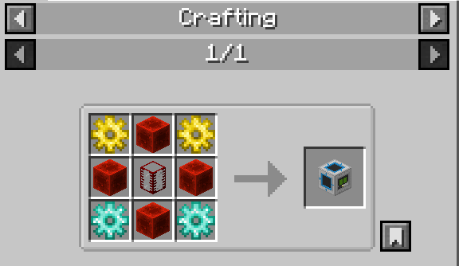
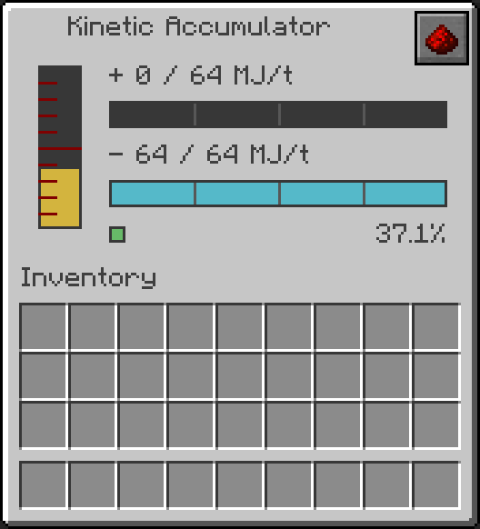
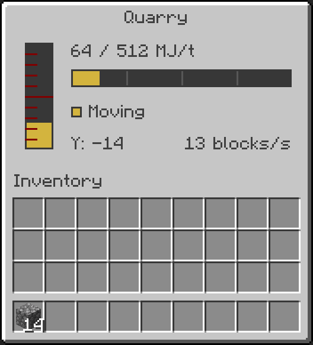

# BuildCraft — Minecraft 1.21.1 / NeoForge — Saltmoth Port

An unofficial adaptation of **BuildCraft 7.99.24.7** by **saltmoth**, made to revisit the original pipes, engines and builders on modern Minecraft. Thank you to SpaceToad and the BuildCraft team for the original mod.

This repository contains the **b70 release download, player documentation and changelog**. It describes the additions and deliberate changes from the original Minecraft 1.12.2 release; unchanged recipes are omitted.

## Download and installation

**[Download BuildCraft b70](https://github.com/saltmoth/BuildCraft-Minecraft-1.21.1-NeoForge-Saltmoth-Port/releases/tag/b70)** · [Changelog](CHANGELOG.md)

| Requirement | Version |
| --- | --- |
| Minecraft Java Edition | 1.21.1 |
| Java | 21 |
| Mod loader | NeoForge 21.1.252 or newer in the 1.21.1 series |
| File | `buildcraft-7.99.24.7-mc1.21.1-neoforge-b70.jar` |
| Optional recipe viewer | JEI for Minecraft 1.21.1 / NeoForge |

Put the JAR in the client's and server's `mods/` folders, replacing any older BuildCraft JAR for this adaptation. Do not install a Minecraft 1.12.2 BuildCraft JAR alongside it. Back up your world before updating.

**This public release includes BuildCraft only.** The Kinetic Accumulator and Quarry interface below are included and work with BuildCraft's own MJ energy system, without IC2.

**IC2 Experimental, Advanced Machines and the Electrokinetic Transducer are not included or available for download in this public release.** IC2 machines, EU conversion and IC2 recipe extensions require the separately maintained private IC2 adaptation. Installing this BuildCraft JAR alone does not provide those features. They are outside this public player guide.

The b70 JAR's SHA-256 is recorded in [SHA256SUMS](SHA256SUMS). The JAR is unchanged by this documentation update.

## Original documentation

Use the [BuildCraft wiki](https://github.com/BuildCraft/BuildCraft/wiki), [original BuildCraft Guide](https://github.com/BuildCraft/BuildCraftGuide) and [official FAQ](https://mod-buildcraft.com/pages/faq.html) for unchanged machines and recipes.

All images below are in-game captures, cropped to the recipe panel or machine interface. In JEI, hover an item and press **R** for its recipe or **U** for its uses. All rates per second assume **20 server ticks per second**. **MJ** means Minecraft Joules; buffer capacity and transfer rate are separate limits.

## Contents

- [Kinetic Accumulator](#kinetic-accumulator)
- [Redstone behavior](#redstone-behavior)
- [Quarry and energy transport](#quarry-and-energy-transport)
- [Oil generation](#oil-generation)
- [Keeping an industry running](#keeping-an-industry-running)
- [Configuration](#configuration)
- [Credits and source requests](#credits-and-source-requests)

## Kinetic Accumulator

A new **BuildCraft MJ battery**, with a front display, **three input ports** and **two output ports**. Its casing and interface follow BuildCraft's machine design.

### Crafting recipe



| Gold Gear | Redstone Block | Gold Gear |
| --- | --- | --- |
| Redstone Block | BuildCraft Tank | Redstone Block |
| Diamond Gear | Redstone Block | Diamond Gear |

**Output:** 1 Kinetic Accumulator. **Total:** 2 Gold Gears, 2 Diamond Gears, 4 Redstone Blocks and 1 BuildCraft Tank. Gears use the common gold/diamond gear tags.

### Ports, capacity and removal

| Part | Purpose |
| --- | --- |
| Front display | Closed; no pipe connection |
| Three blue input ports | Receive MJ through a compatible Kinesis network |
| Two gold output ports | Supply MJ through Wooden Kinesis Pipes |

With a horizontal orientation, the main output is opposite the front and the second output is underneath. Rotate the block with the BuildCraft wrench. **A Gold Kinesis Pipe alone cannot extract energy from an output port**: put a Wooden Kinesis Pipe against that port first.

| Metric | Limit |
| --- | ---: |
| Stored energy | 1,000,000 MJ |
| Combined input across all three inputs | 64 MJ/t |
| Combined output across both outputs | 64 MJ/t |
| Full-rate transfer at 20 TPS | 1,280 MJ/s |
| Ideal empty-to-full time with no output | 781.25 s, about 13 min |

Extra ports make routing easier; they do not multiply the rate. Several BuildCraft MJ sources can share the inputs, but this single battery still accepts and outputs at most 64 MJ/t. A network offering 96 MJ/t cannot make this battery transfer 96 MJ/t.

Flow is averaged over **20 ticks** to make intermittent deliveries readable. A comparator reports the charge level. **Sneak-use a supported wrench to pick up the block with its stored MJ**; the charged item can then be placed again. The redstone mode resets when it is placed from the item.

### Interface



| Display | Meaning |
| --- | --- |
| Vertical gold gauge | Stored energy; hover for the exact MJ reserve and 1,000,000 MJ capacity |
| **+** reading and upper green bar | Combined incoming MJ/t against the shared 64 MJ/t input limit |
| **−** reading and lower cyan bar | Combined outgoing MJ/t against the shared 64 MJ/t output limit |
| Status light and percentage | Availability/paused state and stored charge; hover for output directions |
| Redstone button, top right | Cycle the seven [redstone modes](#redstone-behavior); hover to see the selected mode |

The capture shows a battery discharging at **64 MJ/t** with no incoming supply. Empty flow bars mean no current transfer; they do not mean the battery is empty.

The Accumulator has quiet activity audio while transferring energy and remains silent when idle.

## Redstone behavior

Click the Accumulator's redstone button to cycle through the seven modes. “Full” and “empty” use small reserve margins rather than requiring an exact floating-point value.

| Mode | Behavior |
| --- | --- |
| Nothing | Normal energy output; no redstone signal emitted |
| Emit if full | Emit a signal when the reserve is near full |
| Emit if partially filled | Emit when the reserve is between the empty/full margins |
| Emit if partially filled or empty | Emit while the reserve is below the full margin |
| Emit if empty | Emit when the reserve is below one output unit |
| Do not output energy | An external redstone signal pauses energy output |
| Do not output energy unless full | An external signal pauses output except near full charge |

The four emission modes produce signal strength **15** when their condition is met. With an external signal, the last two modes gate **MJ output**, while the Accumulator may still charge through its inputs. Conditions read the Accumulator's stored MJ.

## Quarry and energy transport

### Modern depth balance

The Quarry reaches below Y=0. Its mining and drill movement costs are normalized for the additional depth, so a modern column does not simply double the old work requirement. Block hardness still matters, and frame construction keeps its original cost.

For a mining box extending below Y=0:

```text
top = maximum box Y + 1
legacy layers = clamp(top, 64, 256)
modern layers = top − minimum box Y
cost factor = max(1/3, legacy layers / modern layers), capped at 1
```

For example, a column with `top = 68` and a minimum Y of `−64` has 132 layers and a factor of **68/132 ≈ 0.515**. Mining/drill MJ costs use this factor, and the task allowance scales inversely. Boxes entirely above Y=0 keep the original cost factor. The adjustment never exceeds a threefold depth compensation.

The Quarry has a hard **512 MJ/t work budget**, at most **4 base tasks per tick**, and at most **12 tasks per tick after depth normalization**. Its drill movement also has a hard ceiling. These limits apply even when the Quarry has stored energy; changing or reconnecting a pipe cannot authorize an unlimited mining burst. A task is not necessarily a mined block: scanning, movement, terrain hardness and output handling affect actual blocks per second.

### Reading the new Quarry interface



Right-click the Quarry to open its read-only metrics. Hover the gauges and labels for exact values and guidance about the energy supply.

| Display | Meaning |
| --- | --- |
| Vertical gold gauge | Internal MJ reserve, up to **24,000 MJ** |
| **MJ/t** reading and horizontal bar | Accepted incoming energy averaged over **20 ticks**, compared with the **512 MJ/t work ceiling** |
| Status light and phase | Setup, scanning, frame building, drill movement, mining, no energy or finished |
| **Y** | Current drill height |
| **blocks/s** | Actual blocks mined in the recent measurement window; it can remain nonzero while the drill moves |

The incoming reading measures delivered energy, not work consumed that tick or the number of connected sources. It may briefly exceed 512 MJ/t while the internal reserve fills; the work budget remains capped at 512 MJ/t and the bar stops at its full width. A full reserve does not remove the work or movement limits. The capture shows **64 MJ/t** being delivered while the drill moves, with a recent mining rate of **13 blocks/s** in the demonstration stone column. This is an example, not a guaranteed rate for every terrain.

One Accumulator's **64 MJ/t** output is **12.5%** of the Quarry's work ceiling. Increasing that battery's input connections cannot turn it into a 512 MJ/t output source. Higher sustained supply requires independent sources and suitable parallel transport; it is optional, not a requirement for the Quarry to finish.

### Demand-based Kinesis transport

Kinesis Pipes transport MJ to requesting consumers **without retaining an energy reserve inside the pipes**. Sources pay only for accepted delivery. When a Quarry finishes, it stops requesting energy; an Accumulator feeding only that Quarry stops discharging. Other consumers on the network can still receive power. The Quarry and Accumulator retain their own legitimate internal reserves.

Use Wooden Kinesis Pipes at the Accumulator output and other Kinesis materials for onward transport. Fluid pipes, item pipes and Kinesis Pipes remain separate networks. Pipe animation shows activity; machine flow readings are the better measure of actual throughput.

## Oil generation

Oil surface clues use irregular connected pools and short, tapered gushers fitted to the surrounding land or ocean. The reservoir remains the extraction target. Native biome, surface-water and world-height handling replace the old terrain assumptions.

These generation changes apply to **new chunks**. Existing deposits are not automatically reshaped.

## Keeping an industry running

Ordinary BuildCraft machines and pipe networks operate in **ticking chunks**.

| System | Behavior when the player leaves |
| --- | --- |
| Engines, ordinary machines and pipe networks | Stop when their chunks cease ticking |
| Working Quarry | Keeps its own block/work area active; does not load a distant power station or its entire pipe route |
| Finished Quarry | Releases its work-area tickets and preserves completion across reloads |

A distant engine station and its pipe route must also remain in ticking chunks, through normal player activity or a separately installed compatible chunk-loading solution. Loading only the Quarry is insufficient for a remote factory. This public BuildCraft release does not include the private IC2 Chunk Loader.

Chunk loading works while the world/server is running. It does not simulate production while a singleplayer world is closed or the server is stopped.

## Configuration

| File | Settings |
| --- | --- |
| `<world>/serverconfig/buildcraft-builders-server.toml` | `quarryNormalizeExtendedDepth` (default true), task, scanning and movement limits |
| `config/buildcraft-energy-worldgen.toml` | Oil generation settings |

A singleplayer world also uses its own `serverconfig/` folder. `defaultconfigs/` can provide defaults for new worlds. Restart for settings that require a restart.

Setting `quarryNormalizeExtendedDepth = false` restores the original mining/drill cost scaling. Configured speed limits can reduce the ceilings; increasing them does not bypass the hard per-tick safeguards.

## Credits and source requests

**Adaptation author and maintainer: saltmoth.** Original BuildCraft by **SpaceToad, the BuildCraft team and its contributors**. See the [retained credits](AUTHORS.txt) and [upstream project](https://github.com/BuildCraft/BuildCraft). The separately maintained private IC2 integration builds on **Alblaka and the IC2 development team's** original energy systems; IC2 is not included here and no ownership of their work is claimed.

This independent, noncommercial project was made for the joy of playing BuildCraft on Minecraft 1.21.1 and aims to preserve the original experience as faithfully as practical after Minecraft's architectural changes. It is **not an official release** and does not claim approval or endorsement by the original teams.

Original code, artwork, names and notices remain subject to their authors' rights. BuildCraft's retained MPL-2.0, older MMPL, API MIT and Forge component notices are provided in [COPYING.md](COPYING.md) and bundled in the JAR. Noncommercial intent does not replace license conditions.

To obtain the corresponding BuildCraft source for a released JAR, use the **[source-code request form](https://github.com/saltmoth/BuildCraft-Minecraft-1.21.1-NeoForge-Saltmoth-Port/issues/new?template=source-request.yml)** and identify the release. Requests are fulfilled free of charge through an electronic download, under the retained component licenses. No email address or other personal information is required. See [source availability](SOURCE_OFFER.md) for the scope; IC2 and Advanced Machines are not part of this offer.
